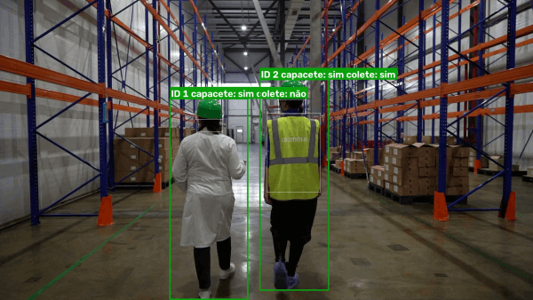
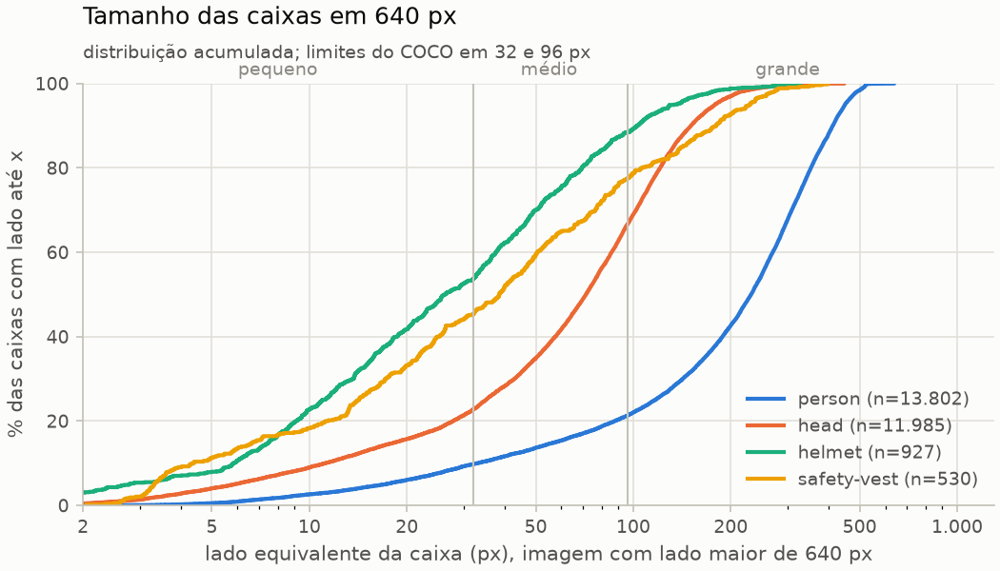
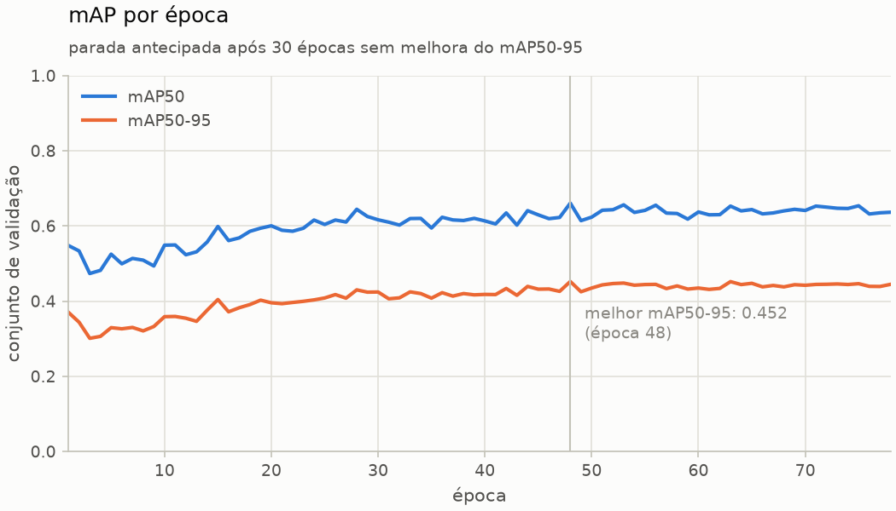
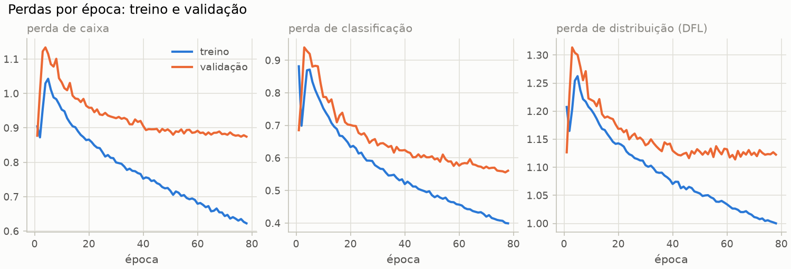
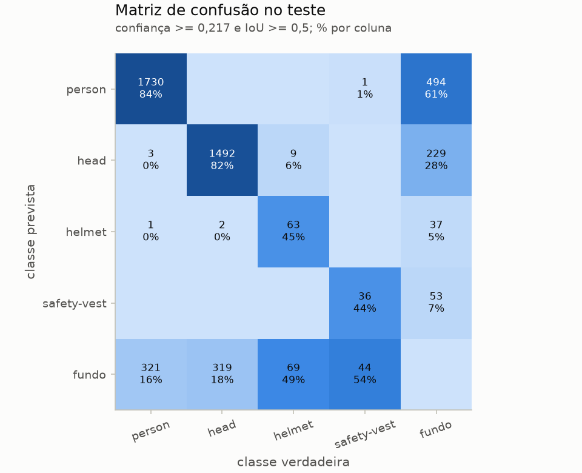
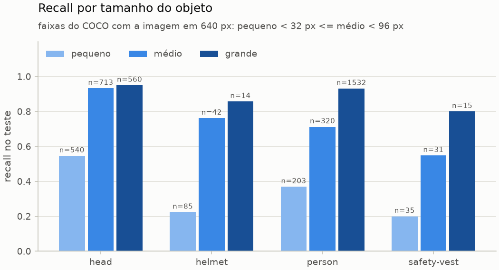
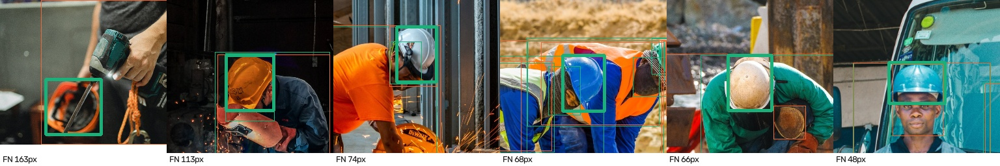
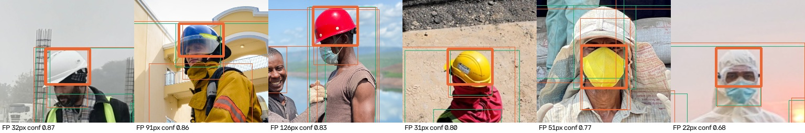
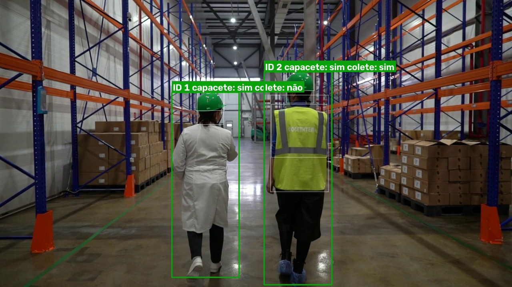
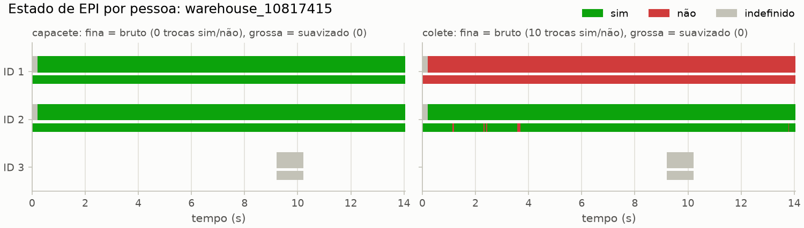

# PPE detection with tracking

[](https://github.com/murilobby/epi-detection/actions/workflows/ci.yml)

[Versão em português](README.md)

Computer vision system that detects helmets and safety vests on workers, gives each person an ID throughout a video with ByteTrack, and records who was missing each piece of PPE and for how long. I fine-tuned a YOLOv8s on the public SH17 dataset, evaluated it on the test set, analyzed the errors and built the tracking on top of the detector.



The color of each person's box shows the helmet state: green for "yes" (sim), red for "no" (não) and gray for "undetermined" (indefinido). The thin white boxes are the helmets and vests assigned to that person. Labels in the images and videos are in Portuguese.

## Results at a glance

- **Detection, on the test set:** mAP50 of 0.653 and mAP50-95 of 0.451. Per class, mAP50 was 0.864 for person, 0.846 for head, 0.483 for helmet and 0.422 for vest.
- **Data:** the official SH17 split leaked photos from the same session between training and validation in 92% of the validation images. I redid the split grouping by photographer.
- **Errors:** helmet recall goes from 22% on small objects to 86% on large ones, and reviewing the false positives turned up real helmets with no annotation in the dataset.
- **Tracking:** stable IDs from start to finish in the warehouse video and no false helmet alarms in the two videos tested. The system only reports missing PPE when the person's head is large enough for the detector to see it.
- **Speed, on an RTX 3060 Ti:** the network runs at about 61 FPS and the full pipeline, writing the annotated video, at 23–29 FPS in 1080p.

## Structure

```
configs/   dataset, training, tracking and ByteTrack configuration, and the split used
scripts/   one script per step, in the order of this README
src/epi/   code used by the scripts: data, evaluation, tracking and plots
reports/   versioned results: analyses, training record, metrics and tracking reports
slurm/     jobs for the NPAD cluster
tests/     tests for PPE assignment, IoU matching and the photographer split
```

Data, weights, videos and training outputs live in `data/`, `models/` and `runs/`, which are not versioned; the commands below recreate everything. The trained weights are also available in a [Release](https://github.com/murilobby/epi-detection/releases/tag/pesos-v1).

## Environment

Python 3.11, PyTorch 2.14.1 with CUDA 12.6 and Ultralytics 8.4.171, running on an RTX 3060 Ti (8 GB) on Windows.

```powershell
python -m venv .venv
.\.venv\Scripts\Activate.ps1
pip install -r requirements.txt
pip install -e .
python scripts\check_gpu.py
```

## Automated tests

The tests in `tests/` cover the logic that does not depend on the model: assigning heads, helmets and vests to each person, smoothing the state over time, the IoU matching used in the evaluation, and the photographer split. They run without a GPU or the weights, and GitHub Actions runs them on every push.

```powershell
pip install pytest==9.2.0
python -m pytest
```

## Quick test

To run the system without training, download the [trained weights](https://github.com/murilobby/epi-detection/releases/tag/pesos-v1) (22.5 MB) and use your own video or the [warehouse video](https://www.pexels.com/video/workers-with-safety-helmets-in-warehouse-10817415/), saved as `data\videos\warehouse_10817415.mp4`:

```powershell
mkdir runs\train\yolov8s_640\weights, data\videos
curl.exe -L -o runs\train\yolov8s_640\weights\best.pt https://github.com/murilobby/epi-detection/releases/download/pesos-v1/best.pt
python scripts\track_video.py data\videos\warehouse_10817415.mp4 --report-dir runs\teste --video-out runs\teste\armazem.mp4
```

The annotated video goes to `runs\teste\armazem.mp4`, and the report to the same folder. Without an NVIDIA GPU, the script also runs on the CPU, only slower.

**Weights license:** they were trained on SH17 and therefore follow the dataset's CC BY-NC-SA 4.0 license: non-commercial use, with attribution and sharing under the same license. The code is under AGPL-3.0 (see [License](#license)).

## Data

I use [SH17](https://github.com/ahmadmughees/SH17dataset) (Ahmad and Rahimi, 2024, [doi:10.1016/j.jnlssr.2024.09.002](https://doi.org/10.1016/j.jnlssr.2024.09.002)), an industry-oriented PPE dataset with 8,099 images from Pexels and 17 classes, under CC BY-NC-SA 4.0. The images are not redistributed in this repository. Of the 17 classes, I use four: `person`, `head`, `helmet` and `safety-vest`.

To download and prepare it (13 GB download; about 29 GB on disk at the end):

```powershell
mkdir data\raw
curl.exe -L -C - -o data\raw\sh17.zip https://www.kaggle.com/api/v1/datasets/download/mugheesahmad/sh17-dataset-for-ppe-detection
python -m zipfile -e data\raw\sh17.zip data\raw\sh17
python scripts\prepare_sh17.py
python scripts\split_dataset.py
python scripts\find_near_duplicates.py
python scripts\analyze_dataset.py
```

Decisions about the data:

- The Kaggle download does not include the file with the class names. I convert from the names in the VOC annotations, without relying on index order. I checked that the YOLO indices match these names in every box and the order of `sh17.yaml` in the official repository.
- In the official split, 92% of the validation images are from photographers who also appear in training, and photos from the same session can be nearly identical. I redid the split as 70/15/15, grouping by photographer and balancing, across the sets, both the number of boxes and the number of images containing each class. Balancing only the boxes left validation with 5 vest images, one of them with 50 vests; now there are 32 in validation and 32 in test. The split used is in [configs/sh17_epi_split.csv](configs/sh17_epi_split.csv).
- I looked for near-duplicates with dHash. In the pairs I inspected, real duplicates had a distance of up to 6 bits (out of 64). In my split, the 2 pairs in that range that cross sets are different images; in the official one, 6 cross and all are from the same photo session. dHash does not detect crops or mirrored images. The pairs found are in [reports/near_duplicates.csv](reports/near_duplicates.csv).
- I reduced the images to at most 1280 px on the longer side. The originals have a median of 23 megapixels, and decoding them every epoch would leave training limited by the CPU.

What the analysis showed ([reports/dataset](reports/dataset)):

- `person` has 26 times more boxes than `safety-vest`. Vests appear in 213 images and helmets in 466.
- With the image at 640 px, 53.6% of helmets are under 32 px per side, the COCO small-object range. At 1280 px, 35.9% are.
- 88% of helmets and vests have at least 90% of their area inside a person box, and 79% of helmets have at least half of their area inside a head box. In other words, SH17 tends to annotate the head even when there is a helmet.
- Only 6.1% of heads have an overlapping helmet: many of the images are not from construction sites or factories.
- In training, 10 photographers account for 53.5% of the images.



## Training

I fine-tuned the COCO-pretrained YOLOv8s, with the configuration in [configs/train_yolov8s_640.yaml](configs/train_yolov8s_640.yaml):

```powershell
python scripts\download_weights.py
python scripts\train.py configs\train_yolov8s_640.yaml
python scripts\summarize_training.py
```

I chose YOLOv8s over YOLOv8n by measuring both on my GPU with [scripts/profile_models.py](scripts/profile_models.py) ([output](reports/train/profile_models_rtx3060ti.txt)). The s has 11.2 M parameters and 28.6 GFLOPs, against 3.2 M and 8.7 GFLOPs for the n. At batch 1, which is how video is processed, both took about 8 ms per frame, and that time was practically the same as what the CPU spends just launching the kernels on the GPU. At batch 32, where the GPU is actually busy, the s cost 2.24 ms per image and the n, 1.14 ms. So, frame by frame, the extra capacity of the s comes almost for free.

Configuration decisions:

- 640 px images, batch 16 with gradient accumulation up to an effective batch of 64.
- SGD with an initial learning rate of 0.01, fixed instead of the automatic mode, which picks the optimizer by the number of iterations and would change with the batch.
- Up to 100 epochs, with early stopping after 30 epochs without improvement in validation mAP50-95.
- Seed 0 and deterministic mode: repeating the training on the same machine gives the same result.

I trained on the RTX 3060 Ti. Training stopped at epoch 78; the best epoch was 48, and it took 1.3 hours counting the validation of each epoch. On validation, the epoch 48 model reached **mAP50 of 0.661 and mAP50-95 of 0.452**. Test set performance is in the [Evaluation](#evaluation) section. The full record, with configuration, versions and commit used, is in [reports/train/yolov8s_640](reports/train/yolov8s_640).



Around epoch 45, the validation box and distribution losses stop falling while the training ones keep falling: the model starts fitting the training set with no gain on new images, and early stopping acted on that plateau.



## Evaluation

```powershell
python scripts\evaluate.py
python scripts\analyze_errors.py
```

I evaluated the model a single time on the test set, which played no part in any decision. The confidence threshold, 0.217, was chosen on validation, as the one that maximizes the mean F1 of the four classes. Results in [reports/eval/yolov8s_640](reports/eval/yolov8s_640):

| Class | mAP50 | mAP50-95 | Precision | Recall | F1 |
|---|---|---|---|---|---|
| person | 0.864 | 0.652 | 0.778 | 0.842 | 0.808 |
| head | 0.846 | 0.607 | 0.861 | 0.823 | 0.842 |
| helmet | 0.483 | 0.300 | 0.612 | 0.447 | 0.516 |
| safety-vest | 0.422 | 0.247 | 0.404 | 0.444 | 0.424 |
| **all** | **0.653** | **0.451** | 0.664 (mean) | 0.639 (mean) | |

- Test mAP50-95 (0.451) matched validation (0.452): choosing the model by validation did not overfit it.
- mAP comes from Ultralytics. I computed precision, recall and F1 in the inference pipeline, with one class per box, matching detections and annotations by IoU >= 0.5 in confidence order. Comparing the two calculations on the validation set, at the same threshold, my helmet and vest numbers came out below Ultralytics': its validation lets one box have several classes (`multi_label=True`), which explained half of the difference in helmet recall. I did not isolate the rest.
- The Ultralytics confusion matrix uses a minimum confidence of 0.001, which works for mAP but does not represent real use. That is why I computed mine at the operating threshold.



What the errors show:

- **Recall drops sharply with object size.** Helmet recall is 22% for small objects (under 32 px), 76% for medium and 86% for large, and 85 of the 141 helmets in the test set are small. All classes follow the same pattern, as the dataset analysis suggested.
- **The model hardly swaps one class for another; it fails to detect.** Of the 78 missed helmets, 69 were not detected as anything and 9 became heads. The count per class and cause is in [error_causes.csv](reports/eval/yolov8s_640/error_causes.csv).
- **In 44 of the 78 missed helmets (56%), the model detected the head in the same place**, but not the helmet.
- **I reviewed all 40 helmet false positives one by one** ([review](reports/eval/yolov8s_640/helmet_fp_review.csv), [all crops](reports/eval/yolov8s_640/fp_helmet_all.jpg)): 22 are other items on the head (caps, protective suit hoods, dust masks), 7 are framing errors over annotated objects, 5 are background, 4 are real helmets with no annotation and 2 are ambiguous. If those 4 were annotated, helmet precision would rise from 0.612 to about 0.650. This is an estimate by visual inspection, not a measurement.



Missed helmets, largest to smallest (green: annotation; orange: detection):



Highest-confidence helmet false positives:



The same examples for vests: [missed](reports/eval/yolov8s_640/fn_safety-vest.jpg) and [false positives](reports/eval/yolov8s_640/fp_safety-vest.jpg).

The examples are crops of SH17 images (Pexels), under CC BY-NC-SA 4.0.

## Tracking

Download the videos with a browser, from the [warehouse](https://www.pexels.com/video/workers-with-safety-helmets-in-warehouse-10817415/) and [construction site](https://www.pexels.com/video/construction-workers-collaborating-on-site-30331740/) pages (the direct link with `curl` may answer 403), and save them as `data\videos\warehouse_10817415.mp4` and `data\videos\site_30331740.mp4`. Then:

```powershell
python scripts\evaluate.py --split val --out reports\eval\yolov8s_640_val
python scripts\calibrate_head_size.py
python scripts\track_video.py data\videos\warehouse_10817415.mp4
python scripts\track_video.py data\videos\site_30331740.mp4
python scripts\analyze_tracking.py reports\track\warehouse_10817415 reports\track\site_30331740
python scripts\snapshot.py runs\track\warehouse_10817415.mp4 reports\track\warehouse_10817415\snapshot.jpg --time-s 9
python scripts\make_gif.py runs\track\warehouse_10817415.mp4 reports\track\warehouse_10817415\demo.gif --start-s 6 --duration-s 4 --width 600
```

In each frame, the detector finds people, heads, helmets and vests; ByteTrack gives each person an ID; and each head, helmet and vest is assigned to the person containing it, with the rules in [src/epi/track/ppe.py](src/epi/track/ppe.py). The configuration is in [configs/track.yaml](configs/track.yaml). The annotated video goes to `runs/track/`, and each person's state in each frame, the stretches without PPE and a summary with times and FPS go to [reports/track](reports/track).

Decisions:

- **People enter ByteTrack from confidence 0.1.** ByteTrack's second association step uses weak detections to keep the ID of someone partially occluded. Head, helmet and vest use the 0.217 threshold chosen on validation.
- **I used the original ByteTrack thresholds** ([configs/bytetrack.yaml](configs/bytetrack.yaml)): a new ID is only born with confidence above 0.6. With the Ultralytics default of 0.25, weak detections of shelves became people: the warehouse video had 5 IDs for 2 people.
- **The system only states that PPE is missing when it can see it.** If the person's head is under 32 px at the model input, or was not detected, the state is "undetermined", not "no". I calibrated this limit on validation with [scripts/calibrate_head_size.py](scripts/calibrate_head_size.py): below 32 px, helmet recall stays at 32% or less; above it, between 70% and 92% ([calibration](reports/track/head_size_calibration.csv)). With 8 px bins, the limit came out at 24 px, but decided by a bin with only 6 helmets; I used 16 px bins, which give the more conservative choice.
- **The state is smoothed over time:** it only changes when 70% of the decisive observations in the last half second agree.

I tested on two Pexels videos, [a warehouse](https://www.pexels.com/video/workers-with-safety-helmets-in-warehouse-10817415/) (1080p, 14 s, by Низам DRedd) and [a construction site](https://www.pexels.com/video/construction-workers-collaborating-on-site-30331740/) (4K, 7.8 s, by aksinfo7 universe). Public videos have no tracking annotation, so I did not compute metrics such as MOTA or IDF1: I checked each ID in the annotated frames.

**Warehouse** (GIF at the top): both people kept the same ID across all 421 frames. Both had helmet "yes" in 98.6% of the frames (the first 6 are the smoothing window filling up), with no false alarms. The only recorded event is true: the person in the white coat went 13.8 s without a vest. In the raw state, the vest flipped 10 times between "yes" and "no"; after smoothing, none. An extra ID lasted 1 s over a shelf and stayed "undetermined", generating no event.





**Construction site:** fixed camera, with six people tracked for most of the video. The [summary](reports/track/site_30331740/summary.json) records 8 IDs: those of the six people (1, 2, 3, 4, 5 and 11) and IDs 12 and 14, which last under 1 s each (17 and 20 frames). Checking the frames, those two are false person detections over the dark opening of a doorway, at the top of the image. They stayed "undetermined", with no head detected, and generated no event.

- The three helmeted workers in front stayed "yes" the whole time, and the two without vests had the vest marked "no", correctly.
- A worker in the background, with helmet and vest, has a 7.7 px head at the model input. Without the size limit, he generated two false alarms; with the limit, he stays "undetermined".
- **The cost:** the seated man in a cap is a real violation, but his head measures 27 px and he also stayed "undetermined". In a 4K video reduced to 640 px, the system prefers not to accuse over accusing without being able to see. Running inference at a higher resolution is the way to judge these people.
- A worker in an orange vest, partially behind another, got vest "no": the occluded vest was not detected.

The annotated frames of the construction site are not in the repository because the people are identifiable, and the Pexels license does not allow showing them in a negative light.

**Speed on the RTX 3060 Ti**, median per frame ([summary](reports/track/warehouse_10817415/summary.json)):

| Step | Warehouse (1080p) | Construction site (4K) |
|---|---|---|
| Read the frame | 2.5 ms | 9.7 ms |
| Network, with preprocessing and NMS | 16.3 ms (61 FPS) | 13.1 ms |
| Tracking and association | 0.9 ms | 1.3 ms |
| Draw and write the video | 15.4 ms | 46.7 ms |
| **Full pipeline** | **34.2 ms (29 FPS)** | **71.2 ms (14 FPS)** |

In 1080p, writing the annotated video costs almost as much as the network. The measurements vary between runs: in four runs on the warehouse video, the network stayed between 55 and 67 FPS and the pipeline between 23 and 29 FPS.

## Cluster

I also prepared the project for the NPAD/UFRN supercomputer, with the Slurm jobs in [slurm/](slurm). The dataset generated there is byte-for-byte identical to the one on my PC, checked with [scripts/dataset_fingerprint.py](scripts/dataset_fingerprint.py), which computes a SHA-256 of each part.

```bash
python scripts/download_weights.py
mkdir -p logs
sbatch slurm/prepare_data.sh
sbatch slurm/train.sh configs/train_yolov8s_640.yaml
```

The compute nodes have neither git nor the `libGL` that OpenCV needs, so I installed both in the conda environment and the jobs load `libGL` from there. The weights are downloaded beforehand, on the login node, because compute nodes may have no internet access.

I tested training on an H200 GPU through the cluster's test queue, but the partition queue had about 27 jobs waiting. Since training on my GPU took 1h20, I trained locally.

I thank the High Performance Computing Center of UFRN (NPAD/UFRN) for the computing resources.

## Limitations

- **Domain.** SH17 consists of stock photos, many outside construction sites or factories, generally taken up close. An industrial security camera, high and distant, would produce more small objects, exactly where the model is weakest. To use the system at a real site, it would be necessary to annotate images from that site and redo the fine-tuning.
- **Helmets and vests have few examples.** The test set has 141 helmets in 70 images and 81 vests in 32 images, so the metrics for these classes would fluctuate with another sample, and I did not compute confidence intervals.
- **Tracking was only verified visually,** on two short videos, without metrics such as MOTA and IDF1.
- **Small people stay "undetermined",** like the man in a cap at the construction site. This is the trade-off chosen to avoid false alarms.
- **Occluded PPE counts as absent** when the person's head is visible, like the orange vest at the construction site.
- **The confidence threshold maximizes mean F1,** which weighs false positives and false negatives equally. In a safety application, missing a violation may cost more than a false alarm, and the threshold should be chosen with whoever operates the system.
- **SH17 annotations have errors,** such as the unannotated helmets found in the review, so measured precision tends to underestimate the real one.

## Next steps

- Run inference, or train, at 1280 px, to judge small people like the man in a cap.
- Export the model to ONNX and TensorRT and run it in C++ or on an embedded device such as an NVIDIA Jetson. TensorRT merges layers and runs the network outside Python, which should reduce the kernel launch cost that dominates the time at batch 1.
- Write the annotated video in parallel or with hardware encoding, which today costs almost as much as the network.
- Annotate frames from real videos to measure MOTA and IDF1 and quantify the performance drop outside SH17.
- Compute bootstrap confidence intervals for the helmet and vest metrics.

## License

The code is under AGPL-3.0, because the project uses Ultralytics YOLO, distributed under that license. The weights published in the Release were trained on SH17 and also follow the dataset's CC BY-NC-SA 4.0 license.
